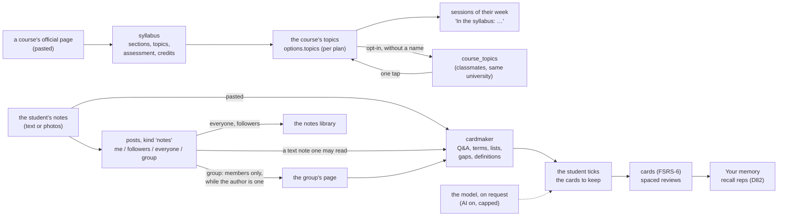

# Study content: syllabi, notes, groups and cards

How the app turns what a student already has (a course's official page, their own
notes, their study group's notes) into a plan's topics and into flashcards. Three
decisions build it: D83 (a whole course page), D84 (flashcards from notes), D85
(notes for a study group), on top of D81 (a course's topics), D26 (the notes
library), D28 (study groups) and D29 (flashcards). The rule throughout: rules first,
on the server, at no cost; the model only when the student asks for it, with AI on.

## The pages

| Page | Address | What it does |
|---|---|---|
| Your courses' topics | `/p/{token}/topics` | each course, its topics or a nudge to add them (D81) |
| A course's topics | `/p/{token}/topics/{n}` | paste the program or the whole course page, read it, see the topics on their weeks with the assessment and the workload (D83), save, share; a classmate's list in one tap |
| Share notes | `/p/{token}/notes/new` (`?group=`) | course, title, notes as text and/or photos, "my own work", who sees it: only me, followers, everyone, a study group (D85) |
| A post | `/p/{token}/post/{id}` | the notes in full; for text notes, "Make flashcards from these notes" |
| A group | `/p/{token}/groups/{id}` | its week, members, invitation, and its notes (D85) |
| Cards from your notes | `/p/{token}/cards/make` (`?note=`) | paste or take a note, read it, tick the cards, choose the course, add (D84); with AI on, "Read them with AI too" |
| Flashcards | `/p/{token}/cards` | decks, reviews (D29), and the way to the card maker |

Every page works without its scripts and only calls `cps.service`.

## The data

| Where | What | Shared with |
|---|---|---|
| `plans` (the plan's document), `options.topics` | a course's topics with their weeks, and `facts`: sections found, assessment parts, credits (D83) | nobody |
| `course_topics` | a topic list offered to classmates (D81) | students of the same university and course name, without a name |
| `posts`, kind `notes` | course, title, a few words, `body` (the notes as text, D85), photos, `own_work`; `visibility` `me`, `followers`, `everyone` or `group` with `data.group` | as chosen |
| `group_members` | who is in a group; decides who sees its notes | |
| `cards`, `card_reviews` | the student's cards and every answer (D29) | nobody |
| `ai_usage` | one row per model call: feature (`cards` among them), tokens, cost | the owner's measures |

No table was added for D83 to D85: the facts live in the plan's document, the group in
the post's data. Deleting a plan deletes its posts, cards and shared lists; its copy
of its data (D43) holds them.

## Free and paid

| Feature | How | Cost to run |
|---|---|---|
| Topics from a pasted course page, assessment, credits | rules | none |
| A classmate's topics | a query | none |
| Notes in a group, the library | the database | none |
| Cards from notes | rules | none |
| Cards written by the model | AI on, asked each time, capped per month and per day | at most $0.20 a call with the default model, $0.005 with the smallest (`python benchmarks/syllabus_cost.py`) |
| A syllabus PDF read by the model | not built (CURRICULUM.md §3a, way E) | at most $0.40 a ten-page PDF with the default model |

The owner named card-making as something students would pay for. What the model adds
is the paid candidate: cards from prose that the rules cannot read. The rules stay
free, so a student without a subscription loses nothing they have today. Prices,
payment and accounts are the owner's decisions; nothing about paying is built.

## Limits

- No real syllabus, course page or set of notes was tried; the rules come from the
  ECTS guide's items ([ref:ects2015]) and from how notes are commonly written, with a
  case per language in `tests/test_generality.py`.
- No model answer has been tried for cards (a fake provider in the tests).
- Photos of notes are not read (that needs the model's vision or an OCR dependency).
- Classmates match by the university and course names as written (D81).
